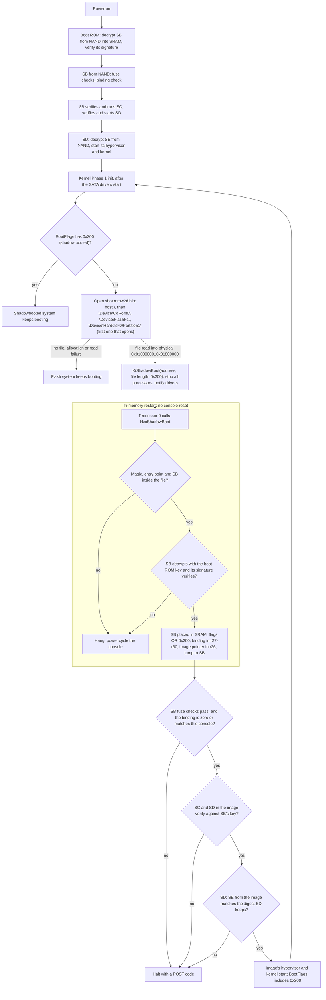

# shadowboot

Compiler for Xbox 360 devkit shadowboot images.

The compiler reads a base image, applies a boot layer, and writes the image's boot region: the flash header followed by the SB, SC, SD, and SE stages. The boot region ends at the boot size the flash header declares, or at the end of the file when the header declares none, as the freeboot and XeLL shadowboot ROMs do. For the verified build 16547 devkit image the output is `0xe0000` bytes.

## Base image

The base is a flash capture or a boot region, such as an earlier compiler output or a shadowboot ROM like RGLoader's `xboxromw2d.bin`. Only the flash header and the SB, SC, SD, and SE stages are read, so any build with that boot chain is accepted, including chains that mix builds and custom stages. The chain may start right after the 0x80-byte flash header, and the header may declare no SMC. Bytes past the boot region are ignored. The base is mapped read-only and is never modified. The output is written to a separate temporary file and renamed into place.

A retail flash cannot be a base. See [Retail consoles and retail flash dumps](#retail-consoles-and-retail-flash-dumps) for why, and for the path to use instead.

The base can also be a raw NAND image with spare areas. The format is detected by default, and `--format` names it when detection fails. The formats are the same as for [`xflash`](../xflash/README.md#image-formats).

A failed integrity check, such as an ECC mismatch in a raw base or an SD signature that does not verify, prints a warning and the image is still written. Pass `--strict` to stop with an error instead.

## How a shadowboot starts

A shadowboot does not reset the console. The kernel that booted from flash reads the image into memory, and the hypervisor starts the image's boot chain from there. This takes the place of the boot ROM's work at power-on. The SMC is not reset, and the image's chain does not come from NAND.



The steps, with the sources in [noscope360](https://github.com/landaire/noscope360) that show them:

1. Early in Phase 1 initialization, after the SATA drivers start, the devkit kernel looks for a shadowboot image unless its boot flags carry `0x200` (`xbox/kernel/src/init/init.c`, `ExpTryToShadowBoot`). It opens `xboxromw2d.bin` under each path in order and uses the first one that opens.
2. The kernel allocates the file's size in physically contiguous memory between `0x01000000` and `0x01800000` and reads the whole file (`ExpTryToBootMediaKernel`). A missing file, a file larger than that window, or a read error prints a diagnostic and the normal boot continues.
3. The kernel waits for the boot animation, then calls `KiShadowBoot` with the image's physical address, its length and the flags `0x200` (`0x600` from the CD-ROM). `KiShadowBoot` stops all processors and notifies the drivers (`xbox/kernel/src/ke/quiesce.c`). Processor 0 calls `HvxShadowBoot`.
4. The hypervisor parks the other threads and checks the flash magic, the entry point and SB's bounds against the file length (`xbox/hv/src/shadowboot/shadowboot.s`, `HvpShadowBootStart`). It decrypts SB with the boot ROM's CB key into SRAM and verifies SB's signature (`HvpShadowBootVerifyCb`), ORs the kernel's flags into SB's header, and jumps to SB. A failure here stops the processor, and the console hangs until it is power cycled.
5. SB runs as it does at power-on, but takes its data from the image in memory because of flag `0x200`. It checks the fuses, checks the console binding unless the binding is zero, verifies SC and SD with its embedded key, and starts SD. SD decrypts SE from the image, compares its digest, and starts the image's hypervisor and kernel. A failed check halts with a POST code.
6. The new kernel sees `0x200` in its boot flags, so it does not look for a shadowboot image again and shows no boot animation. It still reads the console's own NAND for the key vault, the flash boot loader check and the file system.

The boot flags that the new system reports combine the kernel's request with the bits SB sets. For example, a shadowboot of the stock 16547 boot region reports `0x029E`, and the same region with an unbound SB reports `0x029F`. See [Console binding](#console-binding).

## Retail consoles and retail flash dumps

A shadowboot image is built entirely from a devkit boot chain. Nothing in it comes from the flash of the console that boots it:

- The SMC slot and the key vault area of the image are not read on the shadowboot path. See [SMC slot and key vault](#smc-slot-and-key-vault).
- A bound SB checks the console's own NAND, not the image. See [Console binding](#console-binding).
- The retail boot stages (CB, CD, CE) cannot load a shadowboot image. See [Why a retail chain cannot shadowboot](#why-a-retail-chain-cannot-shadowboot).

A retail flash dump is therefore not needed, and the compiler stops with an error when you pass one as `--base`:

```text
shadowboot: error: base image has retail boot stage "CB" at 0x8000.
A retail boot chain does not know how to shadowboot. A devkit boot chain is required: a devkit SB, with an SC and SD signed for it. You can use whatever hypervisor/kernel you want.

Pass --ignore-retail-checks if you really want to use the retail image.
```

### Suggested path

1. Get an existing devkit shadowboot image, such as the `xboxromw2d.bin` that RGLoader ships, or a devkit flash image.
2. Extract its hypervisor and kernel:

   ```text
   shadowboot --base xboxromw2d.bin --extract layer
   ```

3. Replace `layer/boot/hypervisor.bin` or `layer/boot/xboxkrnl.exe` with the hypervisor and kernel you want. Each must have the size of the one it replaces. Delete the file you do not change, or leave it as extracted.
4. Rebuild:

   ```text
   shadowboot --base xboxromw2d.bin --layer layer --output new-xboxromw2d.bin
   ```

5. Copy `new-xboxromw2d.bin` to the root of the HDD as `xboxromw2d.bin`. See [Console filename](#console-filename).

The compiler writes an unbound SB by default, so the image is not tied to the console that the base came from. It also writes the layer directory's name as the copyright text of the flash header. Pass `--default-copyright` to keep the base's text. See [Flash header](#flash-header).

The console must also be able to start a shadowboot. A devkit kernel looks for `xboxromw2d.bin` at boot. See [Loader availability](#loader-availability). The retail build 17559 kernel has no such loader, and its hypervisor halts on the shadowboot call: the handler at `0x31c68` branches to `HvpHalt`. A retail console therefore needs a modified system that provides both. This README does not cover that setup.

### Why a retail chain cannot shadowboot

A shadowboot image needs three parts from a devkit chain. The SE can be any payload that the SD accepts.

- A stock devkit SB that knows the shadowboot path. It takes its data base from the hypervisor, and when the kernel sets flag 0x200 it loads SC and SD from the image in RAM instead of from NAND. A retail CB does neither.
- An SC signed for that SB. SB verifies it with its embedded key and the salt `XBOX_ROM_3`, then skips running it on the shadowboot path.
- An SD signed for that SB, with the same key and the salt `XBOX_ROM_4`.

These findings come from analysis of the hypervisor and SB code, not from tests on hardware.

Third-party ROMs such as the freeboot and XeLL `xboxromw2d.bin` carry patched SBs. From code analysis, and unverified on hardware, such an SB loads only on a console whose hypervisor skips `HvpShadowBootVerifyCb`. A stock devkit hypervisor rejects it.

### Using a retail image anyway

`--ignore-retail-checks` accepts a retail base with a warning that gives the same explanation. A stock console does not shadowboot the result. Only changes that need no stage keys apply:

- A layer can replace whole stages of the base's own chain: `boot/cb.bin`, `cb_a.bin`, `cb_b.bin`, `cc.bin`, `cd.bin` and `ce.bin`. Each is checked by loader ID and the 16-byte placement rules. A replacement CB must keep the retail stage letter and the base's split flag.
- The copyright text applies. See [Flash header](#flash-header).

Anything that needs the devkit key chain fails with an error that says so: `hypervisor.bin`, `xboxkrnl.exe`, `--rebuild-se`, digest updates and `--extract`. The CB binding is not an SB binding, so the compiler leaves it alone and reports `sb-binding=not applicable to a retail CB`. With `--strict`, the retail warning is an error.

## Layer

A layer contains only changed boot inputs. Missing entries are copied from the base image. With `--default-copyright`, an empty layer directory reproduces the base boot region byte-for-byte, unless the base SB is bound to a console (see below) and `--bind` is not given. Without it, the copyright text in the flash header becomes the layer directory's name.

```text
layer/
  boot/
    sb.bin             optional complete encrypted SB stage
    sc.bin             optional complete encrypted SC stage
    sd.bin             optional complete encrypted SD stage
    se.bin             optional complete encrypted SE stage
    hypervisor.bin     optional plaintext hypervisor, the size of the base hypervisor
    xboxkrnl.exe       optional plaintext kernel image, the size of the base kernel
```

`se.bin` conflicts with `hypervisor.bin` and `xboxkrnl.exe`. When either plaintext component is present, the missing component is recovered from the base SE stage. The SE payload is split where the hypervisor header's declared size ends. The compiler emits the verified 32 KiB record framing, 128 KiB LZX stream, chained HMAC-SHA1 key derivation, and RC4 body encryption. A replacement SC nonce changes the SD body key and therefore requires a re-encrypted `sd.bin`. When the selected SC and SD nonces change the SE body key, the compiler rebuilds SE unless `se.bin` is supplied. A supplied SE is decrypted and its complete framing and payload are validated. The resulting boot chain must fit the base image's declared boot region. A separately prepared complete `se.bin` can be used when another compressor is required.

The shadowed system mounts the console's own NAND file system, so flash root files are not part of the output and cannot be changed through a shadowboot image.

SD verifies SE with a RotSumSha digest stored in the SD plaintext at offset `0x24c` and halts on mismatch (SD 16547 compares them at `0xcd4`). The digest covers `SE[0..0x10]` and the decrypted SE body from `0x20` up to the SE size rounded up to 16 bytes. Flash holds SE up to that aligned end; the bytes after the declared size are zero plaintext, encrypted with the SE key. The compiler writes them for every SE it places, and keeps the base bytes when SE is unchanged.

SD is also signed. Its signature covers `SD[0..0x10]` and decrypted `SD[0x120..Size]`, including the SE digest, with salt `XBOX_ROM_4`. When SE changes, the compiler updates a copy of the base SD and signs it with the build 16547 development SD key. A supplied `sd.bin` is written as supplied. An unchanged SE leaves the base SD as it is.

The compiler checks that the base SD keeps the digest of the base SE, that a supplied `sd.bin` keeps the digest of the written SE, and that the base SD signature and the written SD signature verify with the public key in the base SD. A failed check prints a warning and the image is still written. A signature fails when the base SD comes from a build signed with another key, or when a supplied `sd.bin` is not signed. A console that enforces these checks will not boot such an image.

Some ROMs have an SD that keeps no SE digest at `0x24c`, such as freeboot's SD 12611 and XeLL's custom SD. They compile with a warning as long as SE does not change. A layer that changes SE fails with an error, because the compiler has no place for the new digest, unless the layer also supplies `sd.bin`.

`--rebuild-se` recompresses and re-encrypts SE even when the plaintext payload
is unchanged. It cannot be combined with `boot/se.bin`.

## Console binding

A devkit SB taken from a console's NAND is bound to that console. SB+0x20..0x40, decrypted, holds the sequence and digest that the hypervisor writes when it saves the boot loader (`HvxKeysSaveBootLoader`). The digest is an HMAC under the console's CPU key, and SB 14352 halts at POST 0xa2 or 0xa4 on any other console. SB skips the check when the binding is zero, as it is in the RGLoader ROM. The binding lies outside the signed part of SB, which covers the header and 0x140 onward.

By default the compiler writes an unbound SB, so the image boots on any devkit or unlocked console. It decrypts SB with the key derived from the boot ROM key and the SB nonce, clears the binding, and encrypts SB again with the same key. When nothing else changes, only SB+0x20..0x40 is rewritten. The build report says what happened (`sb-binding=cleared` or `sb-binding=unchanged`). This applies to a supplied `sb.bin` too. Pass `--bind` to keep the SB as it is in the base or the layer, for an image that only the bound console boots.

An unbound SB marks itself in the boot flags. When SB finds a zero binding it sets bit `0x0001`, which SD and the hypervisor pass on to the kernel's `XboxHardwareInfo.BootFlags` (SB 14352 `0x1570`). On the stock 16547 devkit, a shadowboot of the stock boot region reports `0x029E` with the bound SB and `0x029F` with the unbound one. The kernel's boot animation check also reads this bit, but a shadowboot already skips the animation. The hypervisor's system update code reads it too (`HvxKeysSaveSystemUpdate`), so do not install system updates or write the flash from a system started with an unbound image.

## Flash header

On the shadowboot path the hypervisor reads only the magic and the entry point of the flash header. The kernel reads the whole file and passes its length on (`ExpTryToBootMediaKernel` in openxbox `kernel/src/init/init.c`), and `HvpShadowBootStart` (`hv/src/shadowboot/shadowboot.s`) checks the image against that length. It never reads the header's boot size, which is why a ROM can leave it zero. The compiler keeps the base's header as it is and checks the output the same way:

- the entry point lies inside the image;
- SB's entry point and SB's end both lie before the end of the image.

The compiler writes a copyright text into the flash header, the bytes `0x10..0x60`. By default the text is the name of the layer directory, so an image built from `--layer rgloader-17489` says `rgloader-17489`. `--copyright <TEXT>` writes the given text instead, and `--default-copyright` keeps the base's own text. The build report says which text was written, for example `copyright="rgloader-17489"` or `copyright=base`.

The text is written NUL-terminated in Latin-1, as Microsoft's own text writes the copyright sign as `0xa9`, and the rest of the field is zero. It can be at most 0x4f bytes. A layer directory name that is longer, or that is not Latin-1, stops the compiler with an error that asks for `--copyright` or `--default-copyright`. The word at `0x60` stays as it is. Since nothing on the shadowboot path reads the text, it cannot affect the boot.

```text
shadowboot --base xboxromw2d.bin --layer layer --copyright "My shadowboot build" --output new-xboxromw2d.bin
shadowboot --base xboxromw2d.bin --layer layer --default-copyright --output new-xboxromw2d.bin
```

## SMC slot and key vault

The SMC firmware and the key vault that the flash header locates in a shadowboot image are never read on the shadowboot path. `HvpShadowBootStart` reads only the header's entry point and the CB header, and no stage reads the key vault offset at 0x6c. The hypervisor's flash base is the fixed physical NAND window `0x80000200c8000000`, and the SMC check of a bound SB hashes the console's own NAND SMC through the flash base at SB+0x258, only when the SB is bound. No stage sends SMC firmware to the SMC. The compiler copies both areas from the base unchanged.

## Extracting the payload

```text
shadowboot --base base.bin --extract layer
```

writes the hypervisor and kernel of the base SE as `layer/boot/hypervisor.bin` and `layer/boot/xboxkrnl.exe`, after checking the SD digest of SE. A failed SD signature check prints a warning. Replace either file and compile with `--layer layer`. An SE that is not an encrypted LZX payload, such as the unencrypted XeLL loader, cannot be extracted, and the compiler says so.

## Size limit

The build 16547 kernel loads the whole file into physically contiguous memory restricted to physical `0x01000000..0x01800000`. An image larger than `0x800000` bytes can never be loaded, and the compiler rejects such output.

## Build

```text
shadowboot \
  --base base.bin \
  --layer layer \
  [--rebuild-se] \
  [--bind] \
  [--copyright TEXT | --default-copyright] \
  [--strict] \
  [--ignore-retail-checks] \
  --output shadowboot.bin
```

## Console filename

For the verified devkit profile, write the compiler output to the HDD root as:

```text
HDD:\xboxromw2d.bin
```

The matching build 16547 kernel tries these paths in this order during a cold boot when the console hardware flag that suppresses shadowboot is clear:

```text
host:\xboxromw2d.bin
\Device\CdRom0\xboxromw2d.bin
\Device\FlashFs\xboxromw2d.bin
\Device\Harddisk0\Partition1\xboxromw2d.bin
```

An allocation or read failure prints a diagnostic and the normal boot continues.

RGLoader ships its ROM the same way: `xboxromw2d.bin` goes in the root of the HDD. The build 17489 kernel looks for `xboxromw2d.bin` under `host:\`, `\Device\FlashFs\`, `\Device\CdRom0\` and `\Device\Harddisk0\Partition1\`.

`\Device\Harddisk0\Partition1` is the device path exposed by XBDM as `HDD:`. The kernel places the strings next to `INIT: failed to read shadow kernel from media.` and `INIT_SHADOWBOOT`, which identifies them as shadowboot media paths rather than flash-update paths.

The filename fields have only the following verified meaning:

- `xboxrom` is the fixed image stem used by the kernel loader.
- `w2d` is literal in the kernel string; its meaning remains unknown.
- `.bin` is the binary image extension.

The evidence is the `0x240000`-byte devkit kernel with SHA-256 `bd57560a12f07eee9d5929b8f3befd93eaea54b6282b5692d165d3e933abf110`.

## Loader availability

`host:\` is the kernel debugger's host file namespace, not a console disk partition or an XBDM drive. With a kernel debugger host attached over kdnet, the kernel sends the open, read, and close requests for `host:\xboxromw2d.bin` to that host as kd host file I/O packets; the openxbdm repository records the packet format in `docs/re-notes/kd.md`. The shadowboot loader sizes its allocation from the file size in the host's open reply. Without an attached host the open fails at once and the loader tries the next candidate. On 2026-10-26 a stock build 16547 kernel accepted all `0xe0000` bytes of its own boot image from `openxbdm-kd host --file 'host:\xboxromw2d.bin=shadowboot.bin'`, completed the shadow boot, loaded `xshell.xex`, and returned through XBDM with boot flag `0x0200` set.

The inspected retail build 17559 kernel does not contain `xboxrom`, `INIT_SHADOWBOOT`, `shadow kernel`, or an equivalent HDD-root loader path. Its SHA-256 is `e1d1c87dbcbec01c71c5400cc129a462fa46738d267e29151a91c5354bdf6cb8`. This establishes that the development media loader is absent from that retail build. It does not establish behavior for every historical retail kernel.

